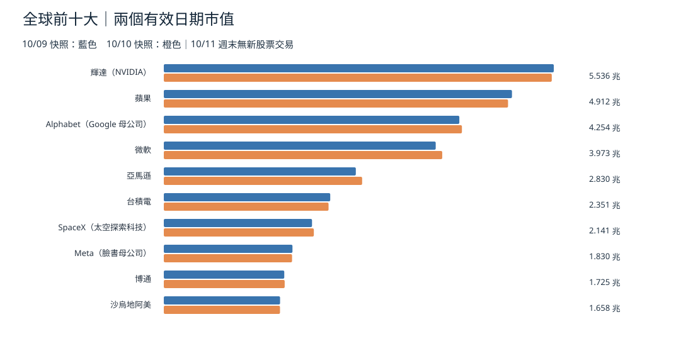
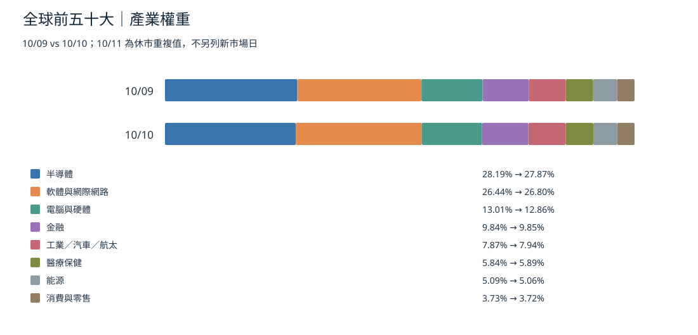
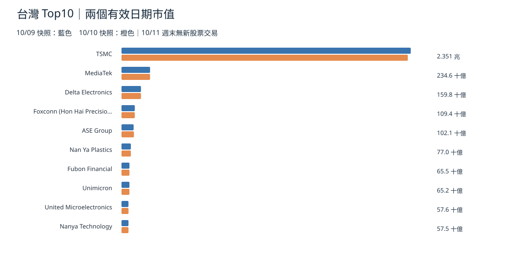
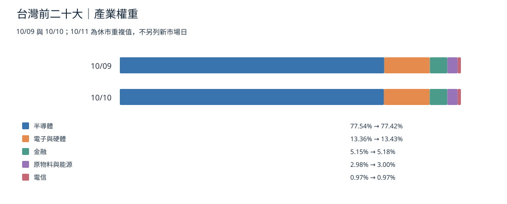
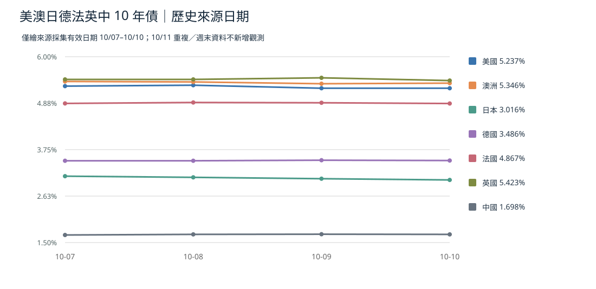
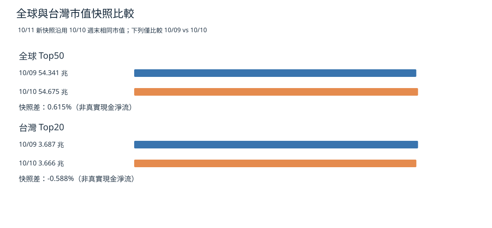

> 補發時間口徑：儲存庫 10/11 快照在 **10/11 07:39 台北**採集，晚於原 05:00 排程；股票市值與 10/10 快照完全相同，**並非 10/11 股市又交易了一天**。本期使用 10/09→10/10 有變化的最後兩次快照。台灣 10/09 休市，美元市值採集差不等於台股股票報酬。[10/11 資料](https://github.com/tibame201020/signal-notes/blob/main/data/market/snapshots/2026-10-11.json)、[10/10 資料](https://github.com/tibame201020/signal-notes/blob/main/data/market/snapshots/2026-10-10.json)、[10/09 基準](https://github.com/tibame201020/signal-notes/blob/main/data/market/snapshots/2026-10-09.json)。

## 全球 Top10 市值（跨快照）

全球 Top50 合計自 **54.341 兆美元**至 **54.675 兆美元**，跨快照 **+0.615%**；資料籃子含成分及時間差，不是固定成分指數，亦不是資金淨流。**依據：** 以上 儲存庫 原始快照。**為什麼這樣判斷：** 市值為價格 × 股數，來源網站與美元換算均可能變化。

## 全球 Top50 產業份額

[全球 Top50 附來源日 CSV](./global-top50-2026-10-11.csv)。產業份額是權重變化，不可推成各產業實際基金流入。

## 台灣 Top10 市值

台灣 Top20 合計 **3.687 兆→3.666 兆美元（-0.588%）**。**台灣 10/09 休市**，兩次網站美元快照差包含匯率／採集和估值口徑，不能假定是真實本地交易跌幅。

## 台灣 Top20 產業份額

[台灣 Top20 附來源日 CSV](./taiwan-top20-2026-10-11.csv)。

## 七國 10 年公債殖利率

最新 儲存庫 10/11 快照所列值：美國 **5.237%**、澳洲 **5.346%**、日本 **3.016%**、德國 **3.486%**、法國 **4.867%**、英國 **5.423%**、中國 **1.698%**。其 `source_date` 均為 10/10（週末採集標籤），不可稱週日新交易。殖利率非房貸利率；澳洲銀行房貸定價與家庭可支配所得傳導有時差。**依據：** 儲存庫 sovereign_10y；[澳洲來源](https://tradingeconomics.com/australia/government-bond-yield)。

## 總市值快照（不是資金淨流）

## 實際資金淨流：另用基金統計

Reuters 10/09 發布 LSEG Lipper 截至 10/07 一週：全球貨幣基金 **+1,538.1 億美元**、債券基金 **+260.3 億**、股票基金 **+5.6 億**。這是**先前一週**淨申贖，非 10/11 新發生。**依據：** [Reuters 10/09 基金流](https://www.reuters.com/world/china/global-markets-flows-graphic-2026-10-09/)。

**為什麼這樣判斷：** 將實際份額申贖與市值重估分圖，才不會將資產價格變化錯寫成現金流。

## 昨日、三日、七日與資料缺口
昨日 10/10 主要是週末消息、沒有新的完整全球股票交易日；近三日可用 10/08–10 快照比較，但採集時點不同；近七日只有 10/07 起完整 Top50/台灣 Top20 資料，不造七日市值增減。若下一交易日市場重新開盤，以上估值風險需重新核對。此篇的七張圖表保留兩個有效日期／來源時戳，不以重複點冒充增量。
