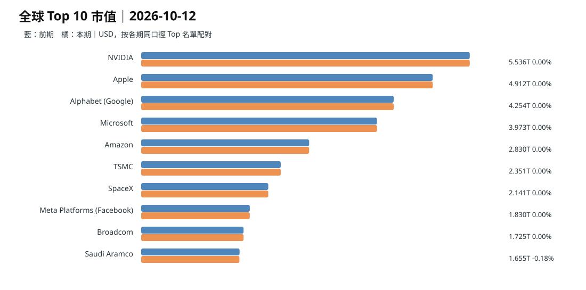
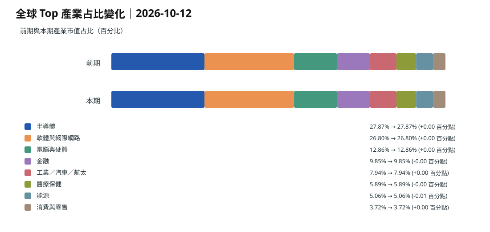
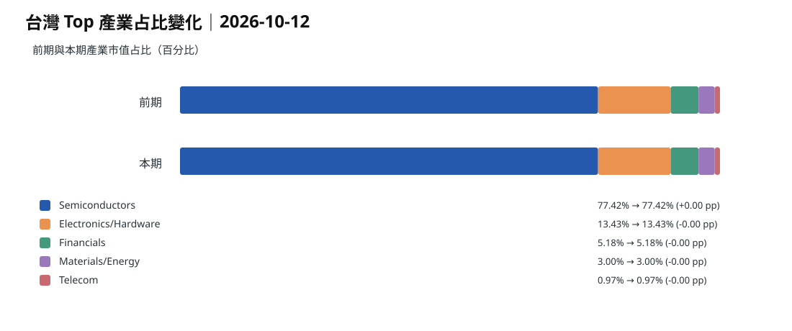
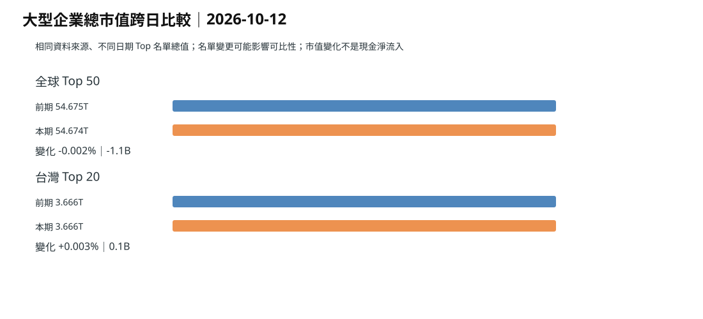
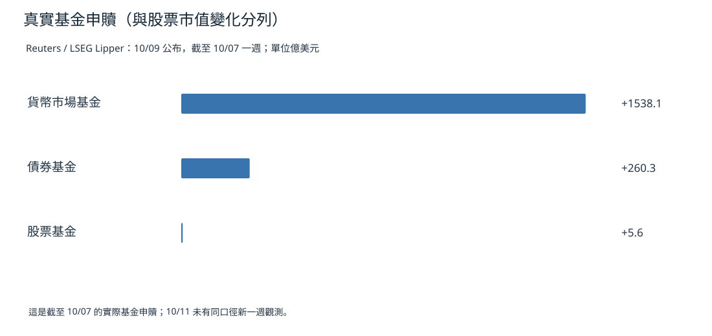

> **資料缺口：截至補發檢查時，repo 沒有 `data/market/snapshots/2026-10-12.json`。** `data/market/latest.json` 的 `as_of` 仍是 **10/11**，採集時間 **10/11 07:39 台北**（10/10 23:39 UTC）。其中全球 Top50／台灣 Top20 市值與 10/10 快照相同；因週末休市，不是 10/11 新市場回報。以下圖表和 CSV 明確重用 **10/09→10/10 有變化的有效快照**，不聲稱 10/12 市場已交易。資料：[10/11 snapshot](https://github.com/tibame201020/signal-notes/blob/main/data/market/snapshots/2026-10-11.json)、[10/10 snapshot](https://github.com/tibame201020/signal-notes/blob/main/data/market/snapshots/2026-10-10.json)、[10/09 snapshot](https://github.com/tibame201020/signal-notes/blob/main/data/market/snapshots/2026-10-09.json)。

## 全球 Top10 市值（最近兩個有效採集日）

全球前 50 大合計：**54.341→54.675 兆美元（+0.615%）**。此為兩次網站市值快照差，受成分與報價時間影響，**不是 10/11–12 的新股市報酬，更不是現金淨流**。**依據：** repo 10/09、10/10 原始快照。**為什麼這樣判斷：** 市值變化可能由價格、股數、匯率、樣本組成及採集差造成。

## 全球 Top50 產業權重

[全球 Top50 市值 CSV：來源日 10/11，實際最新股票採集值與 10/10 相同](./global-top50-2026-10-11.csv)。

## 台灣 Top10 市值（最近有效採集）

台灣 Top20 合計：**3.687→3.666 兆美元（-0.588%）**。10/09 台灣休市，加上 10/10、10/11 為週末，因此來源美元快照差不得寫為 10/12 台股跌幅。

## 台灣 Top20 產業權重

[台灣 Top20 市值 CSV：原始來源日與交易日明列](./taiwan-top20-2026-10-11.csv)。

## 美澳日德法英中十年債

| 市場 | 10/11 最新 repo 快照記錄 | 來源日期 |
| --- | ---: | --- |
| 美國 | 5.237% | 10/10 標籤（週末，需當作延續值） |
| 澳洲 | 5.346% | 10/10 |
| 日本 | 3.016% | 10/10 |
| 德國 | 3.486% | 10/10 |
| 法國 | 4.867% | 10/10 |
| 英國 | 5.423% | 10/10 |
| 中國大陸 | 1.698% | 10/10 |

這些均**不是 10/12 新交易**。澳洲長債殖利率維持高平台，影響銀行資金成本及浮動房貸重新定價，但不能由一個債率數字推斷當週零售已下降。**依據：** [repo 快照](https://github.com/tibame201020/signal-notes/blob/main/data/market/snapshots/2026-10-11.json)、[Reuters｜澳洲 AI 投資與通膨](https://www.reuters.com/world/asia-pacific/ai-boom-fuel-australia-inflation-despite-higher-rates-ex-rba-official-says-2026-10-08/)。

**為什麼這樣判斷：** 房貸利率是銀行定價、信用利差、產品及合約重設共同作用，非十年債殖利率的機械映射。

## 跨日總市值

## 真實基金淨流：另列，不與市值混算

10/09 發表的 LSEG Lipper 資料顯示：截至 10/07 的一週，貨幣市場基金 **+1,538.1 億美元**、債券基金 **+260.3 億**、股票基金 **+5.6 億**。這是最後可核實週度基金淨流，不是 10/12 當日金流。**依據：** [Reuters｜10/09 週度基金流](https://www.reuters.com/world/china/global-markets-flows-graphic-2026-10-09/)。

## 昨日、三日、七日的有效性

- **10/11：** 週日新聞與局部可交易市場有新事件；全球／台灣 Top50／Top20 沒有新股票收盤，快照重複不繪假漲跌。
- **10/09–11：** 最後有效市值採集由 10/09 至 10/10；週末 carry-forward 標示清楚，債率用 source_date。
- **10/05–11：** 10/07 才有完整市值榜單，不能造七日完整價格趨勢；債率可用 10/05 起的歷史快照，應排除重複週末點。

**推論：** 10/11 利雅德機場事件可能改變下個開市日風險溢價，但這是**未來待測**，不是 10/12 凌晨已觀察到的股價變動。**依據：** [AP｜10/11 機場](https://apnews.com/article/d2e0868ffb18d883c16465d7d6a87ccb)。**為什麼這樣判斷：** 市場定價需到真正可交易時段才會成為觀測值。
