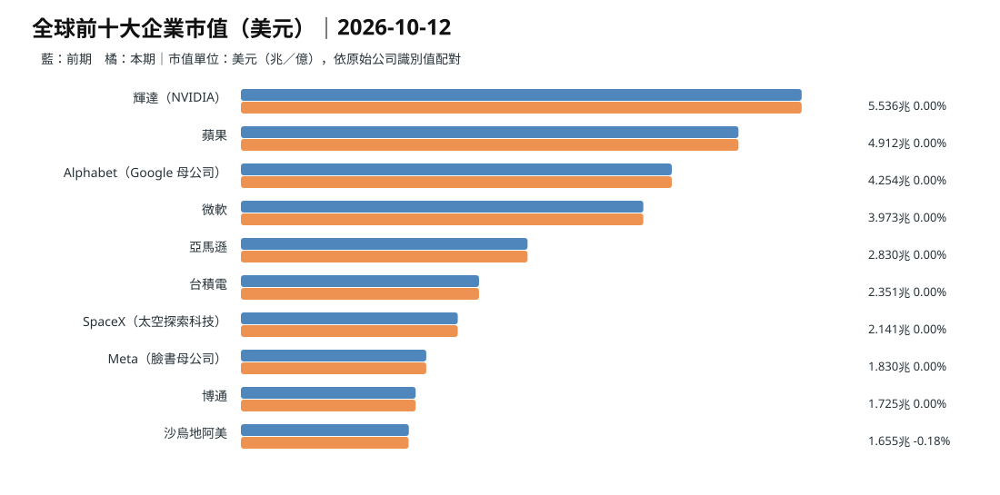
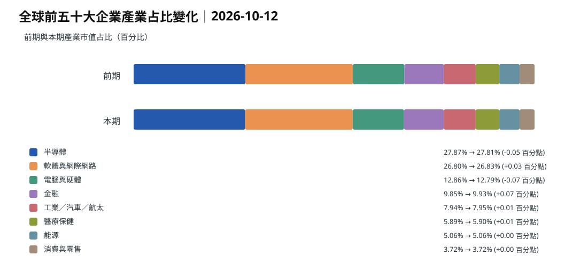
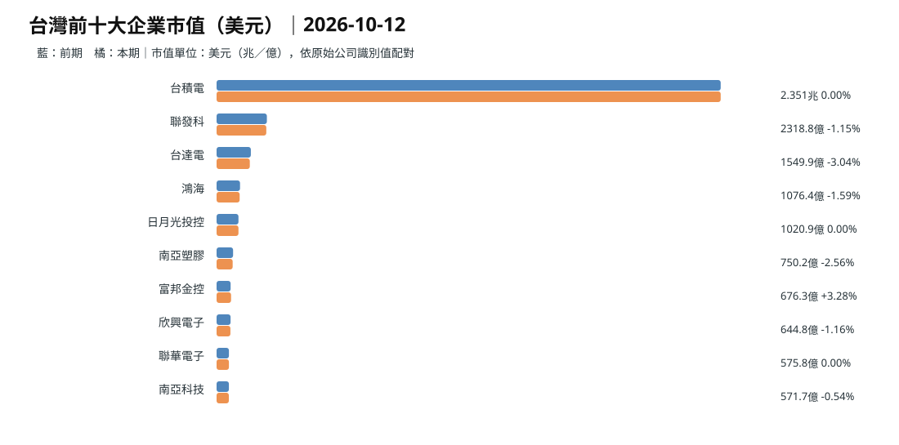
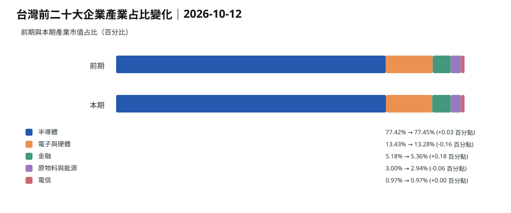
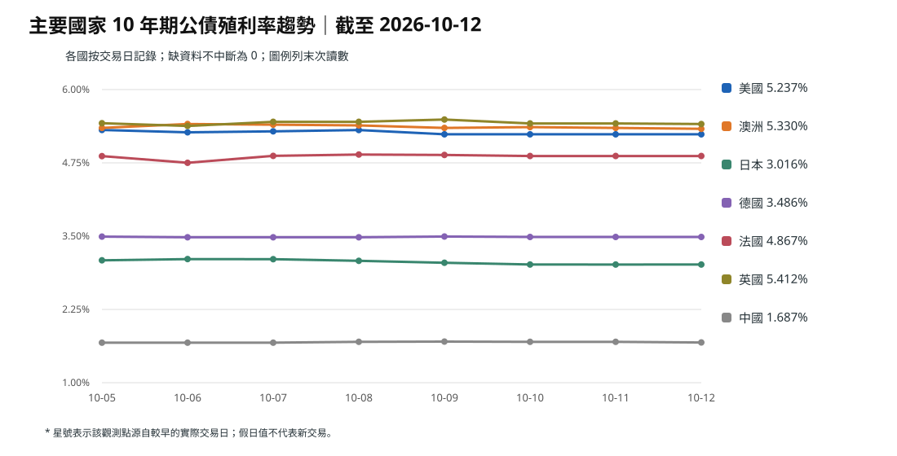
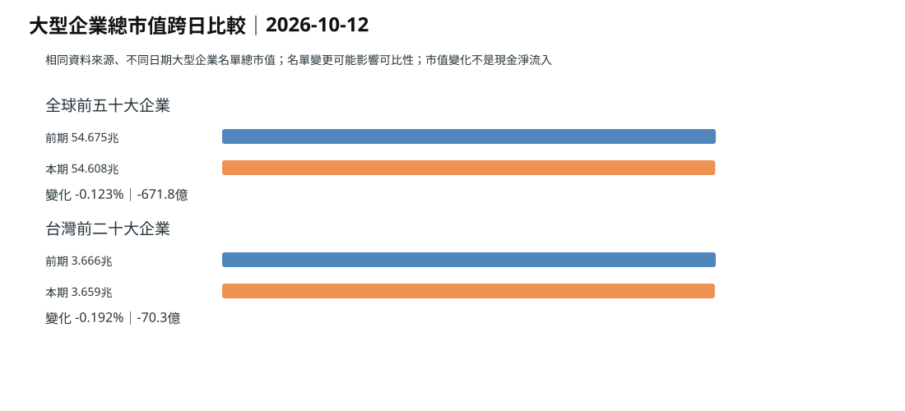

> **資料版本：** 台北 10/13 凌晨截稿時，最新 `data/market/latest.json` 的觀測日是 **10/12**，採集時間為 **2026-10-12 05:49:33 UTC（台北 13:49:33）**；**10/13 快照缺失**。以下圖表及下載表格完整沿用已發布的 **10/12 同一版本**，圖內日期也明示 10/12。這不是 10/13 新收盤，亦非 05:00 已取得的新資料。[10/12 原始快照](https://github.com/tibame201020/signal-notes/blob/main/data/market/snapshots/2026-10-12.json)、[10/11 比較快照](https://github.com/tibame201020/signal-notes/blob/main/data/market/snapshots/2026-10-11.json)。

## 全球前十大企業市值

全球前五十大企業總市值由 10/11 版本 **54.67480 兆美元**至 10/12 版本 **54.60762 兆美元**，差額 **-0.06718 兆美元（-0.123%）**。榜單成分、價格與匯率均可能影響數字，**市值減少不等於資金淨流出**。

## 全球前五十大企業產業占比

圖中產業採繁體中文名稱，比例變化單位為**百分點**。[下載全球前五十大企業資料表](./global-top50-2026-10-12.csv)，中文公司及產業欄位置前，原始識別值保留在後。

## 台灣前十大企業市值

台灣前二十大企業總市值由 **3.66555 兆美元**至 **3.65852 兆美元**，約 **-0.192%**。這是資料網站的美元市值採集比較，**不是台灣證券交易所 10/12 官方指數報酬**。

## 台灣前二十大企業產業占比

本期樣本中半導體約 **77.45%**、電子與硬體約 **13.28%**、金融約 **5.36%**；分母僅為前二十大公司，不是全市場。[下載台灣前二十大企業資料表](./taiwan-top20-2026-10-12.csv)。

## 七國十年期公債殖利率

| 市場 | 10/12 快照來源值 |
| --- | ---: |
| 美國 | 5.237% |
| 澳洲 | **5.330%** |
| 日本 | 3.016% |
| 德國 | 3.486% |
| 法國 | 4.867% |
| 英國 | 5.412% |
| 中國大陸 | 1.687% |

**來源日期**均標為 10/12，但採集時間早於部分市場當日正式收盤。澳洲十年債高於美國、低於英國；長債 → 銀行資金成本 → 房貸報價與重設 → 家庭可支配所得 → 消費，有銀行定價及合約時滯。不能用十年債單日變動直接宣稱消費下降。**依據：** [澳洲央行金融穩定報告](https://www.rba.gov.au/publications/fsr/2026/mar/the-global-macro-financial-environment.html)。

## 全球與台灣大型企業總市值

此圖衡量估值重估，並非實際基金淨申贖。

## 真實基金申贖：與市值分列

Reuters 10/09 引述 LSEG Lipper **截至 10/07 一週**：貨幣市場基金淨流入 **1,538.1 億美元**、債券基金 **260.3 億美元**、股票基金 **5.6 億美元**。這是歷史週度資料，不是 10/12 或 10/13 新流量。**依據：** [Reuters｜10/09 基金申贖](https://www.reuters.com/world/china/global-markets-flows-graphic-2026-10-09/)。

## 昨日、近三日、近七日
昨日 10/12：最後採集版為台北 13:49；近三日 10/10–12：週末可能沿用前一交易日行情；近七日 10/06–12：跨日曲線依實際保存資料，缺值不補零。**推論：** 能源與利率風險須以交易價格、基金淨申贖及公司現金流交叉驗證。**依據：** 上述快照與 Reuters。**為什麼這樣判斷：** 價格重估不能證明真實資金流向。
