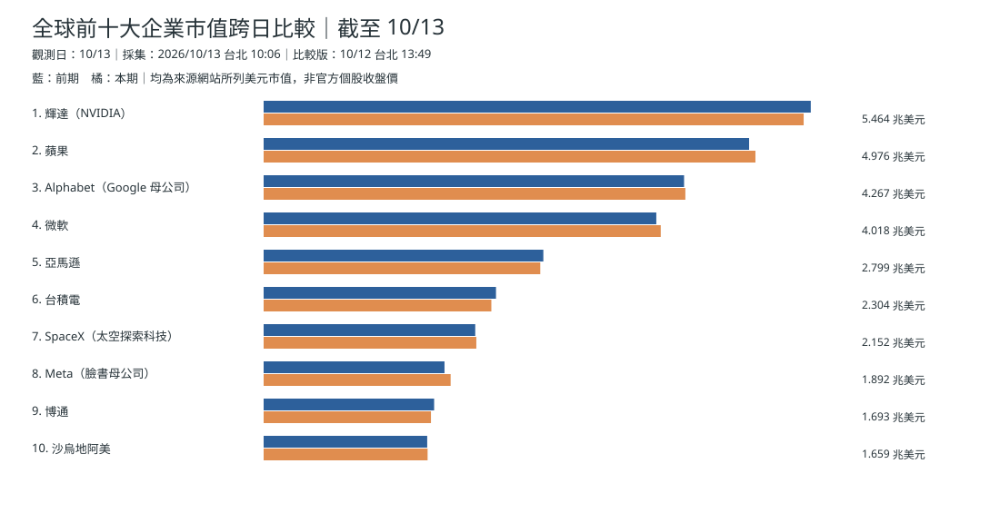
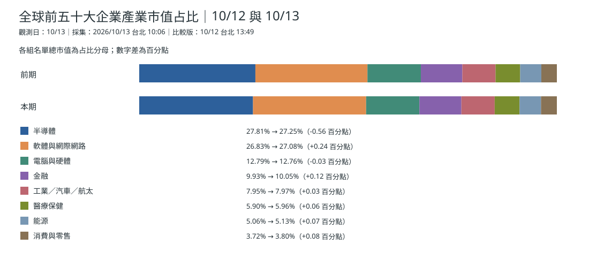
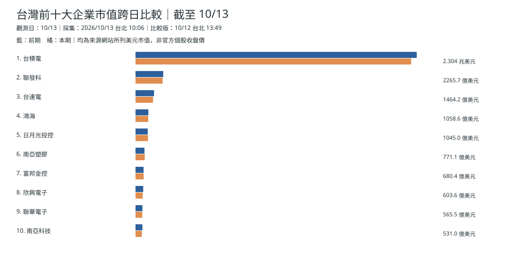
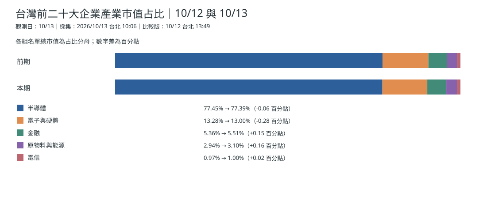
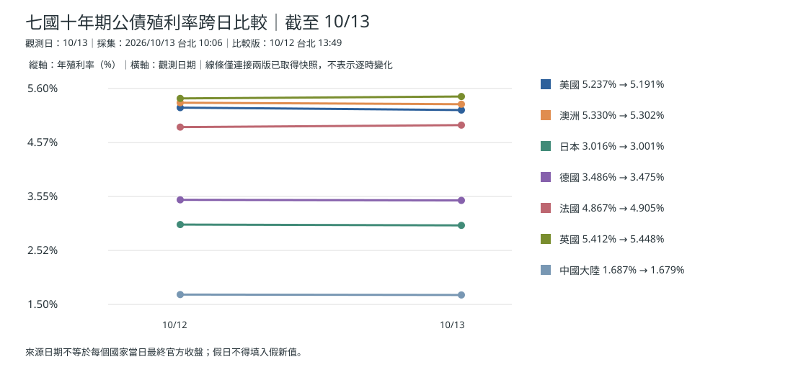
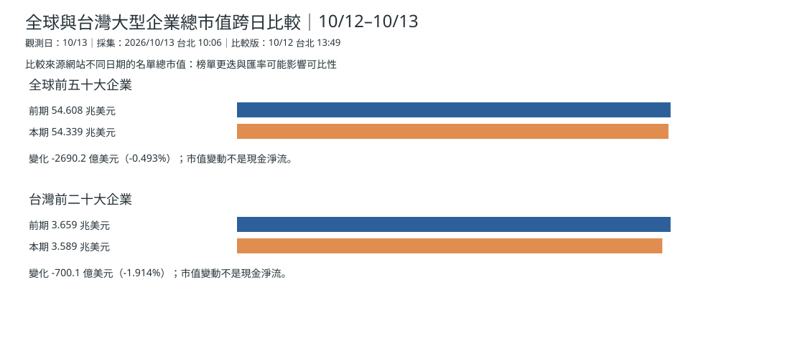

> **補刊說明：** 原訂 2026/10/14 台北 05:00 發布，實際於 10/15 補刊。分析時點限定 10/14 05:00 前可核對資料；只有來源日期而未見確切發稿時分的資訊，不視為當時已可取得的即時行情。

## 資料版本及時序
本期分析可得的最後快照為 **2026/10/13 02:06:31 UTC（台北 10:06:31）**，資料觀測日 **10/13**。10/14 版本直到台北 **07:45:55** 才採集，因此不納入原訂 05:00 研究，也不冒充 10/14 開盤前資訊。[本期原始快照](https://github.com/tibame201020/signal-notes/blob/main/data/market/snapshots/2026-10-13.json)、[前期快照](https://github.com/tibame201020/signal-notes/blob/main/data/market/snapshots/2026-10-12.json)。圖說日期代表快照版本，並非所有市場正式收盤日。

## 全球前十大企業市值

## 全球前五十大企業產業占比

[下載全球前五十大企業資料表](./global-top50-2026-10-13.csv)。

## 台灣前十大企業市值

## 台灣前二十大企業產業占比

[下載台灣前二十大企業資料表](./taiwan-top20-2026-10-13.csv)。

## 多國十年債走勢

澳洲 10/13 快照為 **5.302%**，美國 **5.191%**。債券殖利率到澳洲房貸和消費的傳導須經銀行資金成本、合約重訂價及家庭現金流，不可等同當天零售銷售已下降。[澳洲央行](https://www.rba.gov.au/publications/fsr/2026/mar/the-global-macro-financial-environment.html)。

## 估值變化與真正基金流量

10/12→10/13：全球前五十大名單總市值 **54.60762→54.33860 兆美元**（約 -0.493%）；台灣前二十大 **3.65852→3.58851 兆美元**（約 -1.914%），成分變更與匯率亦可能造成差異。**這不是資金淨流出。** 可核對的實際基金淨申贖是 Reuters 10/09 引述截至 10/07 一週的貨幣市場基金淨流入 **1,538.1 億美元**、債券基金 **260.3 億美元**、股票基金 **5.6 億美元**，不冒稱新的一週。[Reuters｜基金申贖](https://www.reuters.com/world/china/global-markets-flows-graphic-2026-10-09/)。

## 昨日／三日／七日
10/13：市值快照下降；10/11–13：週末資料可能重複，不算新交易；10/07–13：依實際交易日與採集時點讀圖。**推論：** 資本成本和盈利預期共同影響市值。**依據：** 同版快照和基金週度來源。**為什麼這樣判斷：** 估值重估和真實資金淨申贖是不同的衡量對象。
