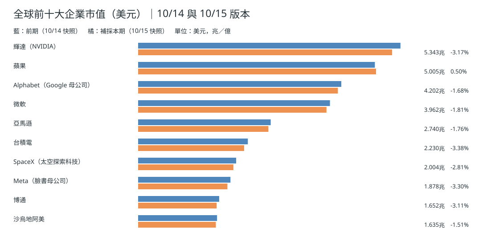
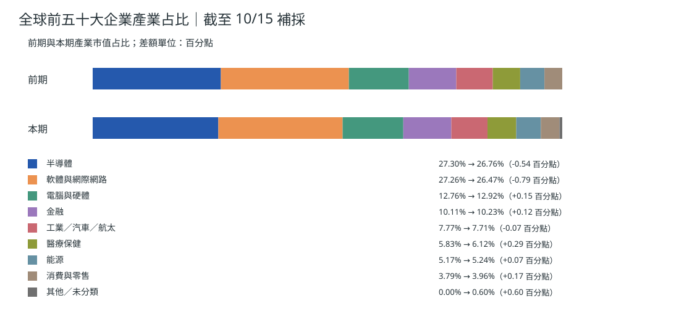
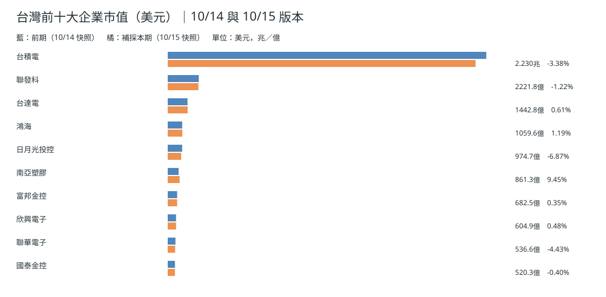
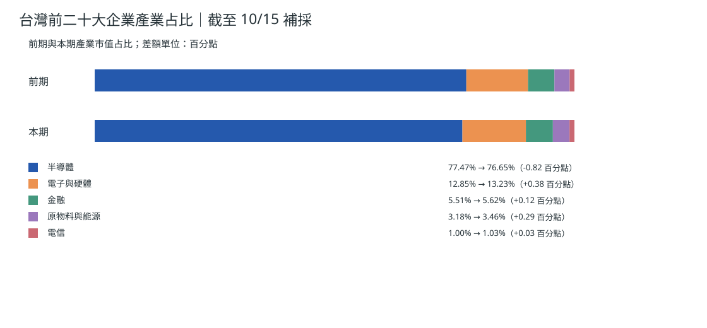
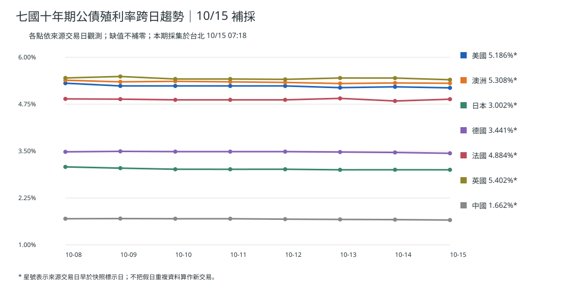
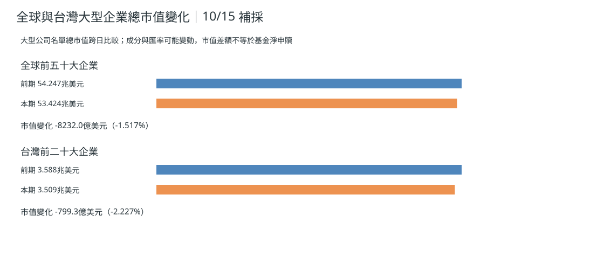

> **補刊及資料時序：** 原訂 10/15 05:00 時，當日 04:20 快照尚未取得。最近可得資料為台北 10/14 07:45:55 採得的 10/14 版。本篇為實際補刊，另採用 **台北 10/15 07:18:34**（UTC 2026-10-14T23:18:34.281Z）才完成的 10/15 版作圖；不能聲稱下列數字在 05:00 已取得。資料版本日期不等於各個交易所的正式收盤日。[本期補採原始資料](https://github.com/tibame201020/signal-notes/blob/main/data/market/snapshots/2026-10-15.json)、[上期資料](https://github.com/tibame201020/signal-notes/blob/main/data/market/snapshots/2026-10-14.json)。
## 全球前十大企業市值

## 全球前五十大企業產業占比

[下載全球前五十大企業中文資料表](./global-top50-2026-10-15.csv)。
## 台灣前十大企業市值

## 台灣前二十大企業產業占比

[下載台灣前二十大企業中文資料表](./taiwan-top20-2026-10-15.csv)。
## 七國十年債趨勢

補採的澳洲 **5.308%**，美國 **5.186%**、日本 **3.002%**、德國 **3.4413%**、法國 **4.884%**、英國 **5.4022%**、中國 **1.6621%**；各國原始觀測日期均逐項保存於來源快照。澳洲長債透過銀行融資成本、房貸重訂價與家庭可支配所得，才可能傳到零售消費，不能當成即時已發生的消費減量。[澳洲央行研究](https://www.rba.gov.au/publications/fsr/2026/mar/the-global-macro-financial-environment.html)。
## 市值變化與真正資金淨流

以同一資料來源的 10/14→10/15 採集版本比較，全球前五十大企業名單總市值 **54.24737→53.42417 兆美元（-1.517%）**；台灣前二十大 **3.58846→3.50853 兆美元（-2.227%）**。排名名單成分可能變動，這是估值總額，不是可交易股票的精確資金淨流出。真實資金淨申贖需另採基金或交易所專項資料；本次未取得 10/14 同口徑基金申贖，不填造。
## 昨日／三日／七日
10/14 主要市場價格變化反映於 10/15 補採資料；10/12–14 要依各地交易日辨別假日重複；10/08–14 比較各日已採集的公司名單與公債。**推論：** 美國通膨改變貼現率可能促進高資本支出公司重新定價。**依據：** [美國 10/14 正式通膨](https://www.bls.gov/news.release/archives/cpi_10142026.htm)與同版快照。**為什麼這樣判斷：** 市值是股數乘價格，無法直接得出淨買賣現金流。
