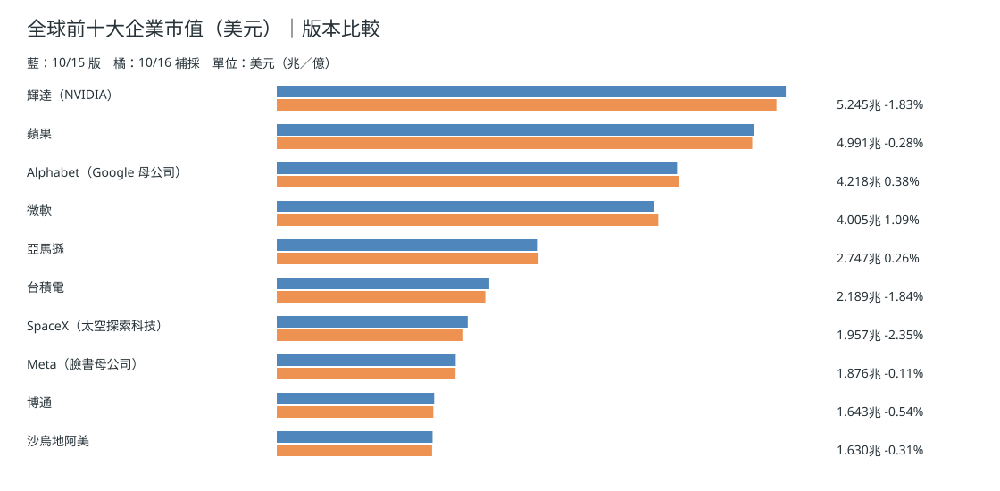
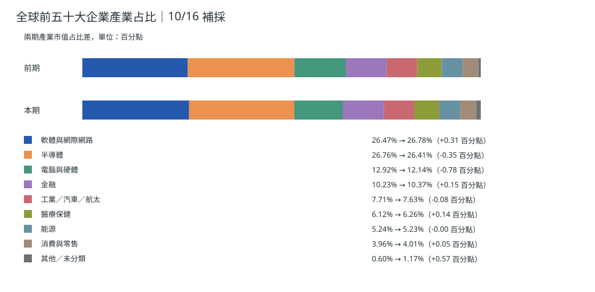
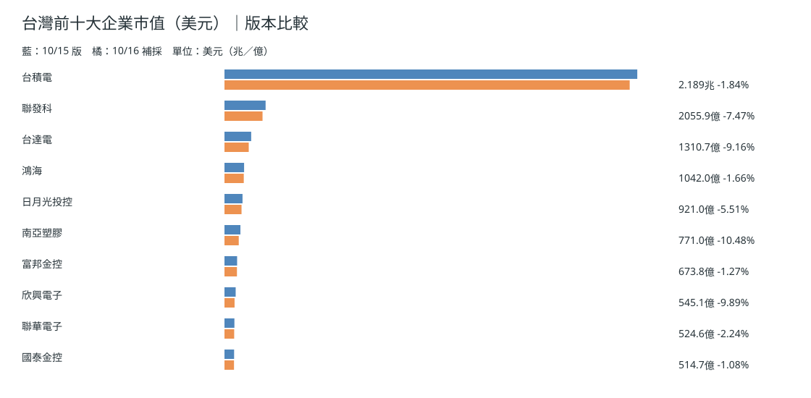
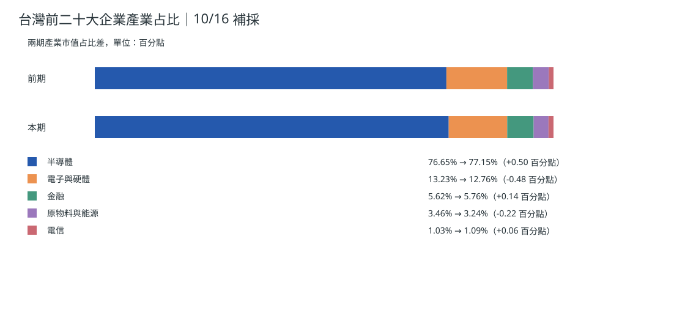
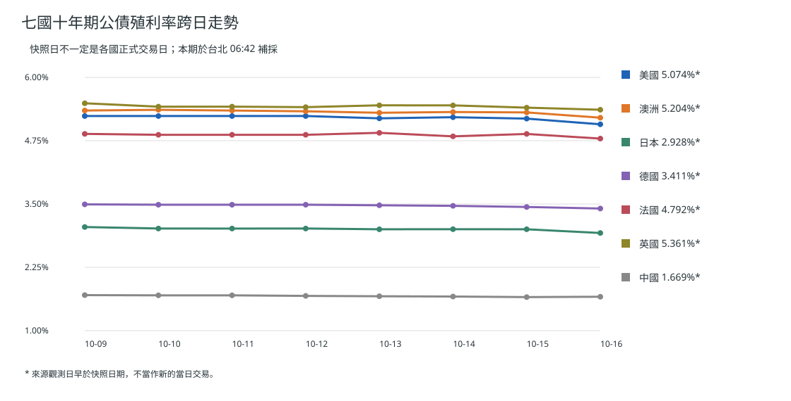
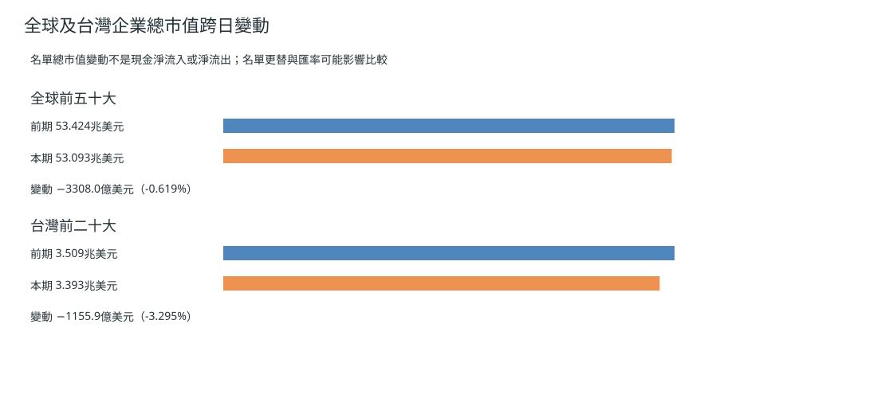

> **補採版本：** 原訂 10/16 05:00 的市場資料工作未產生執行紀錄；本文圖表統一用台北 **06:42:50**（UTC 2026-10-15T22:42:50.634Z）補採的 10/16 版，前期為 10/15 版，不能聲稱 05:00 已取得。[本期原始快照](https://github.com/tibame201020/signal-notes/blob/main/data/market/snapshots/2026-10-16.json)、[前期快照](https://github.com/tibame201020/signal-notes/blob/main/data/market/snapshots/2026-10-15.json)。
## 全球前十大企業市值

## 全球前五十大企業產業占比

[下載全球前五十大企業中文資料表](./global-top50-2026-10-16.csv)。
## 台灣前十大企業市值

## 台灣前二十大企業產業占比

[下載台灣前二十大企業中文資料表](./taiwan-top20-2026-10-16.csv)。
## 七國十年債走勢

補採資料顯示美國 **5.074%**、澳洲 **5.204%**、日本 **2.928%**、德國 **3.4108%**、法國 **4.792%**、英國 **5.3614%**、中國 **1.669%**；圖內星號表示來源觀測日早於快照日。澳洲債率先影響銀行融資及新房貸報價，再透過重訂約壓縮或釋放家庭可支配所得；不能直接等同當日消費已改變。[澳洲央行報告](https://www.rba.gov.au/publications/fsr/2026/mar/the-global-macro-financial-environment.html)。
## 市值變動不是資金淨流

10/15→10/16 快照全球前五十大合計為 **53.42417→53.09337 兆美元**；台灣前二十大為 **3.50853→3.39294 兆美元**。成分變動與匯率可能使比較不完全一致；市值乘股價變化不是基金現金淨申贖，當期缺同時點完整淨申贖，故不造數字。
## 昨日／近三日／近七日
10/15 正式台積電獲利與全球避險訊號並存；10/13–15 需按實際交易日辨識價格變化；10/09–15 以市值、債率分開觀察。**依據：** 同版快照及[公司正式季報](https://investor.tsmc.com/english/quarterly-results/2026/q3)。**為什麼這樣判斷：** 經營獲利與市場貼現率是不同變數，不可把市場下跌直接當現金外流。
