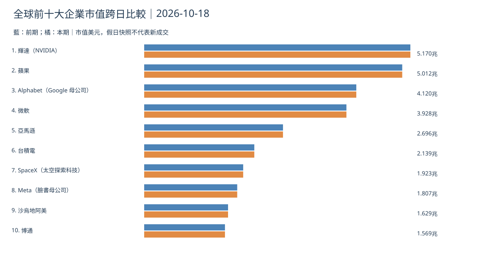
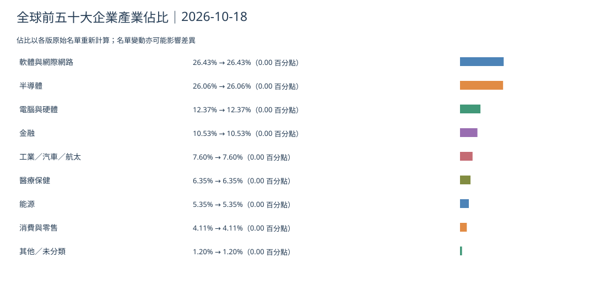
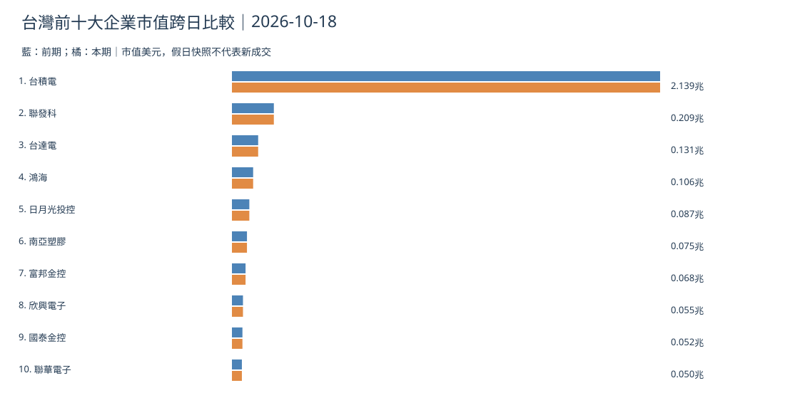
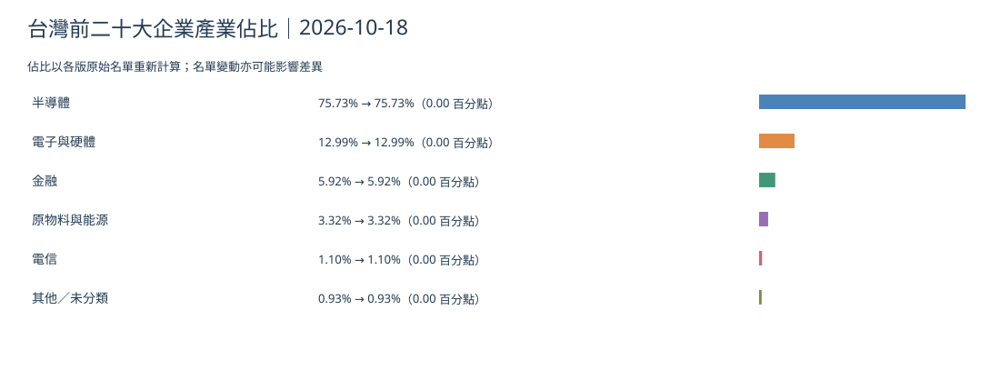
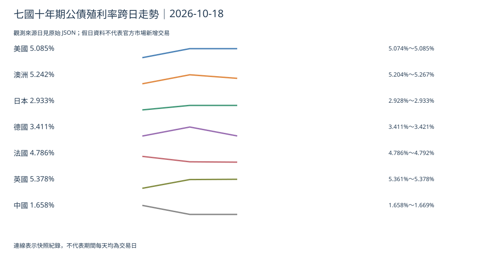
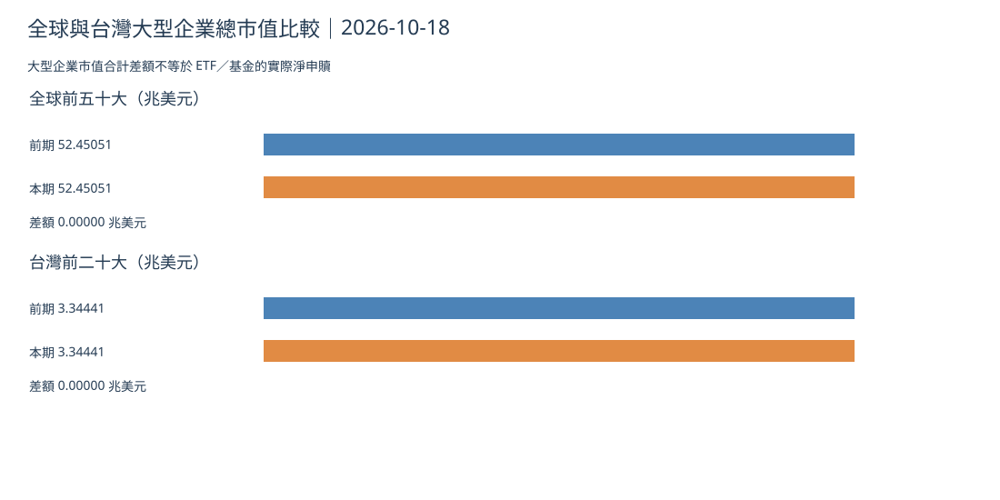

> **歷史補刊：** 原定 2026-10-18 臺北 05:00 截稿。本期市場快照實際於臺北 2026/10/18 06:26:34 採集，晚於原訂截稿，只列作事後補採，不倒填為當時已知。未能核實公告精確時分的資料只作日期層級補刊回顧，週末快照不視為新交易。[本期原始資料](https://github.com/tibame201020/signal-notes/blob/main/data/market/snapshots/2026-10-18.json)。

## 全球前十大企業市值

## 全球前五十大產業市值佔比

[全球前五十大繁體中文來源 CSV](./global-top50-2026-10-18.csv)。

## 台灣前十大企業市值

## 台灣前二十大產業市值佔比

[台灣前二十大繁體中文來源 CSV](./taiwan-top20-2026-10-18.csv)。

## 七國十年期公債

本期快照美國 5.085%、澳洲 5.242%、日本 2.933%、德國 3.4109%、法國 4.7856%、英國 5.3776%、中國 1.6584%；週末即使來源標記不同日期，也不能當成新官方交易。

## 全球與台灣總市值跨日比較

2026-10-17→2026-10-18：全球前五十大 **52.45051→52.45051** 兆美元；台灣前二十大 **3.34441→3.34441** 兆美元。名單變動或資料來源更新可能影響可比性。市值合計差額不是 ETF／基金淨申贖；缺獨立實際現金流資料故不報淨額。

## 昨日／近三日／近七日
昨日與 2026-10-17 快照比對；三日注意週末休市；七日比對相同公司識別與各國債券的真正來源觀測日，缺值不補零。休市期間應將上週高槓桿算力公司的股債風險與正式業績並列；重複市值不代表週末出現真實現金進出。 [當期報導](https://www.reuters.com/world/china/delegates-walked-out-imf-steering-committee-meeting-when-russian-official-spoke-2026-10-17/)。

**資料血緣：** [本期 JSON](https://github.com/tibame201020/signal-notes/blob/main/data/market/snapshots/2026-10-18.json)、[前期 JSON](https://github.com/tibame201020/signal-notes/blob/main/data/market/snapshots/2026-10-17.json)、[唯一繁中顯示映射](https://github.com/tibame201020/signal-notes/blob/main/scripts/market-data/display-zh.mjs)。CSV 先列中文欄位再保留原始英文識別欄位。
