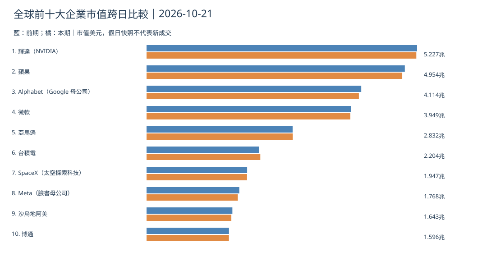
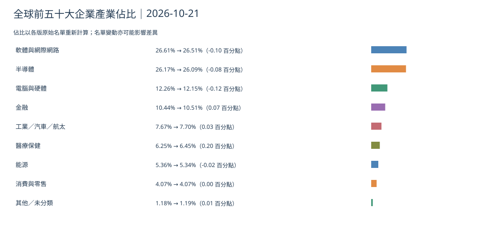
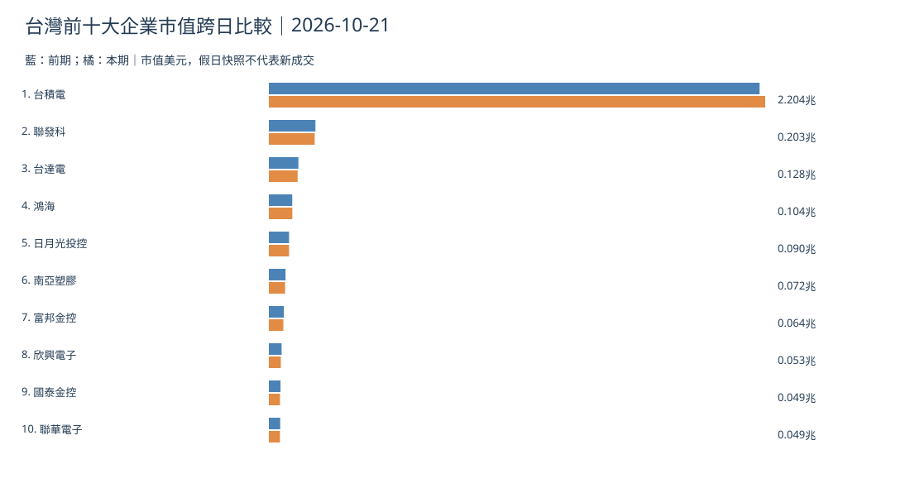
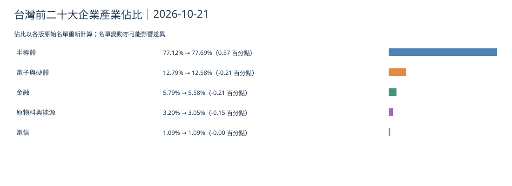
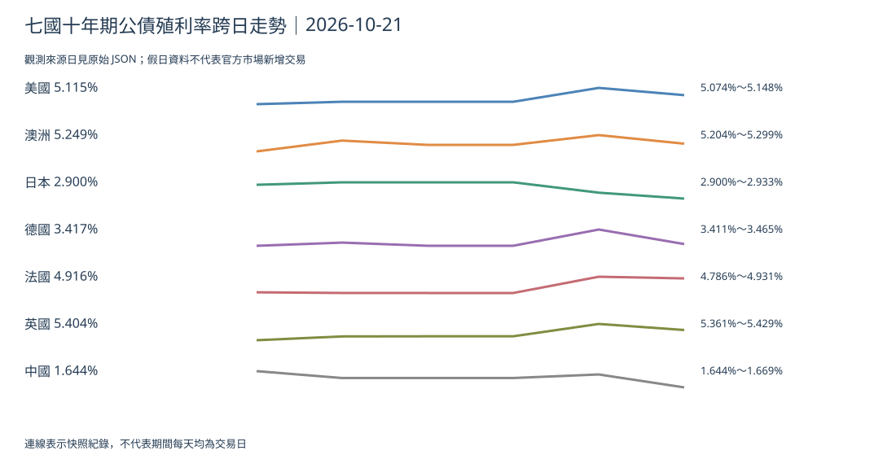
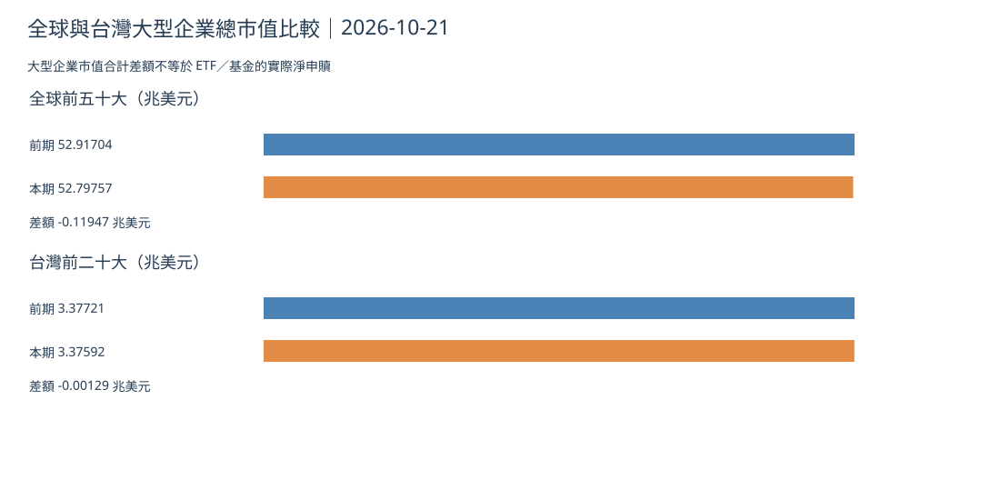

> **資料時點：** 文章日 10/22；最後可用快照標記 **10/21**，採集於臺北 **10/21 07:13:59**，債券實際來源觀測日 **10/20**。以下保留 10/21 已生成的原始圖表與 CSV，**不是 10/22 新圖或新行情**。[快照](https://github.com/tibame201020/signal-notes/blob/main/data/market/snapshots/2026-10-21.json)。

## 全球前十大市值

## 全球前五十大產業占比

[全球前五十大中文 CSV](./global-top50-2026-10-21.csv)
## 台灣前十大市值

## 台灣前二十大產業占比

[台灣前二十大中文 CSV](./taiwan-top20-2026-10-21.csv)
## 七國十年債

## 市值合計跨日

十月二十日至二十一日快照，全球前五十大合計 **52.91704→52.79757 兆美元**，台灣前二十大 **3.37721→3.37592 兆美元**。名單變動及估值變化可能影響可比性；**市值差額不是資金淨流量**。

**澳洲：** 十年債來源觀測日 10/19 至 10/20 為 **5.299%→5.249%**，下降 **0.050 個百分點**。**推論：** 長債可能經銀行融資與固定房貸重新定價影響消費。**依據：** [前期快照](https://github.com/tibame201020/signal-notes/blob/main/data/market/snapshots/2026-10-20.json)。**為什麼這樣判斷：** 公債不是房貸契約利率，單日下降不代表已降息。

## 昨日／近三日／近七日
昨日可用 10/21 採集資料；近三日比較真實債券觀測日；近七日辨識跨日公司與產業樣本。週末重複不視為新交易。缺 10/22 快照不能執行當日新圖生成，待補採需明示並人工核對。
